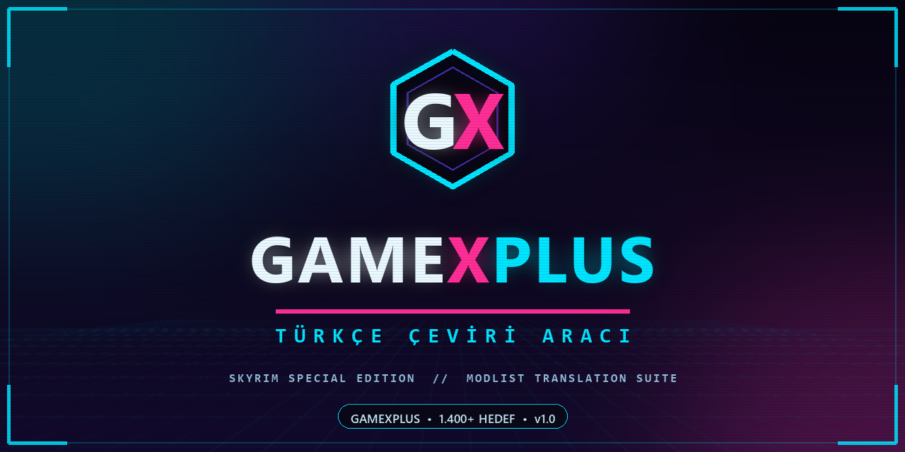

<p align="center">
  
</p>

<h1 align="center">GAMEXPLUS — Skyrim SE Türkçe Çeviri Aracı</h1>

<p align="center">
  <b>GAMEXPLUS</b> mod listesi için hazırlanmış, siberpunk temalı Türkçe çeviri kurulum aracı.<br>
  Nolvus Awakening çeviri aracının (<a href="#lisans">c0kadam</a>, BSD-3-Clause) GAMEXPLUS profiline uyarlanmış sürümü.
</p>

<p align="center">
  
  
  
  
  
</p>

---

## Neler var?

- **GAMEXPLUS kimliği** — pencere başlığı, açılış bandı, simge, renk vurguları ve kurulum bildirimi tamamen GAMEXPLUS markasına göre ayarlandı.
- **Siberpunk görünüm** — neon ızgara desenli banner, camgöbeği (`#00E5FF`) parlama, koyu mor (`#1B0F3B`) vurgu rengi ve çok boyutlu GX simgesi.
- **GAMEXPLUS'a özel manifest** — yalnızca GAMEXPLUS profilinde gerçekten etkin olan modların hedefleri alındı: **1.428 hedef**, **418 benzersiz indirme**. Profilde bulunmayan **285** Nolvus kaydı ayıklandı.
- **Çevrimdışı çalışma** — tüm çeviri listesi paketin içinde; ilk açılış dışında internet gerekmez.
- **OTA kanalı** — bu depodaki `GAMEXPLUS/index.json` üzerinden liste doğrulanabilir (isteğe bağlı).

## Hızlı başlangıç

1. `BASLAT.bat` dosyasına çift tıklayın.
2. Açılan **Çeviri listesi bağlantısı** ekranında **Yerel** seçeneğini seçip **Seçili kaynağı yükle** düğmesine basın.
3. Mod Organizer 2 klasörünü seçin:
   `E:\GAMEXPLUS\Instances\Gamexplus\MO2`
4. Profil olarak **GAMEXPLUS** seçin ve **Profili Tara** adımını çalıştırın.
5. Premium Nexus API anahtarınız varsa otomatik indirme akışını, yoksa NXM bağlantılarıyla manuel indirme akışını kullanın.
6. **Çeviriyi Hazırla** ile çıktı modunu oluşturun ve MO2'de etkinleştirin.

> Çıktı modunun adı **GAMEXPLUS - Turkce Ceviri** olarak ayarlıdır.

## Depo içeriği

```
assets/
  gamexplus-social.png     1280x640 depo/sosyal medya kartı
  gamexplus-banner.png     2172x724 uygulama içi banner
  gamexplus.ico            çok boyutlu GX simgesi
GAMEXPLUS/
  index.json               OTA dizini (manifest URL + SHA-256)
  manifest.json            GAMEXPLUS çeviri listesi (1.428 hedef)
  manifest.json.sha256     manifest bütünlük özeti
LICENSE                    BSD-3-Clause (özgün yazar)
AUTHORS.md                 özgün atıf
THIRD_PARTY_NOTICES.md     üçüncü taraf bildirimleri
```

## OTA kanalı

Uygulama açılışta listeyi doğrudan bu depodan çekebilir. Bunun için:

```
https://raw.githubusercontent.com/Poseidon12x/skyrim-gamexplus-modlist-turk-e-eviri/main/GAMEXPLUS/index.json
```

`index.json` içindeki `sha256`, `manifest.json` dosyasının SHA-256 değeridir:

```
2fdff166c36ca901fc12a58b453ac6e064b23e7f7999dbe183ddc6e9cbd33b10
```

Manifesti güncellerseniz **üç dosyayı birlikte** yenileyin (`manifest.json`, `manifest.json.sha256`, `index.json`). Aksi halde araç listeyi reddeder.

## Teknik notlar

- Ana yürütülebilir dosya upstream `CeviriAraci.exe` ile **bayt düzeyinde aynıdır**; yalnızca adı değiştirildi. Böylece araç, upstream sürümün bütün doğrulamalarından geçmiş güvenilir ikili olarak kalır.
- Görsel kimlik, uygulamanın çalışma anında okuduğu `release/branding.json`, `release/gamexplus-banner.png` ve `release/gamexplus.ico` dosyalarıyla uygulanır.
- Derlenmiş ikilide sabit metin/renk tablosuna yapılan her müdahale uygulamayı `0xC0000409` ile düşürdüğü için tema, çalışma zamanı marka dosyaları üzerinden verilir.
- Yalnızca HTTPS ve `allow_hosts` listesindeki alan adları kabul edilir; indirme sayacı/telemetri yoktur.

## Lisans

- Arayüz ve dönüştürme motoru: **c0kadam** — Nexusmods Translation Download Wizard, BSD-3-Clause. Özgün lisans ve atıf dosyaları (`LICENSE`, `AUTHORS.md`) korunmuştur.
- GAMEXPLUS markası, manifest uyarlaması ve görsel kimlik: **GAMEXPLUS**.

<p align="center"><sub>GAMEXPLUS • Skyrim Special Edition • Türkçe Çeviri</sub></p>
